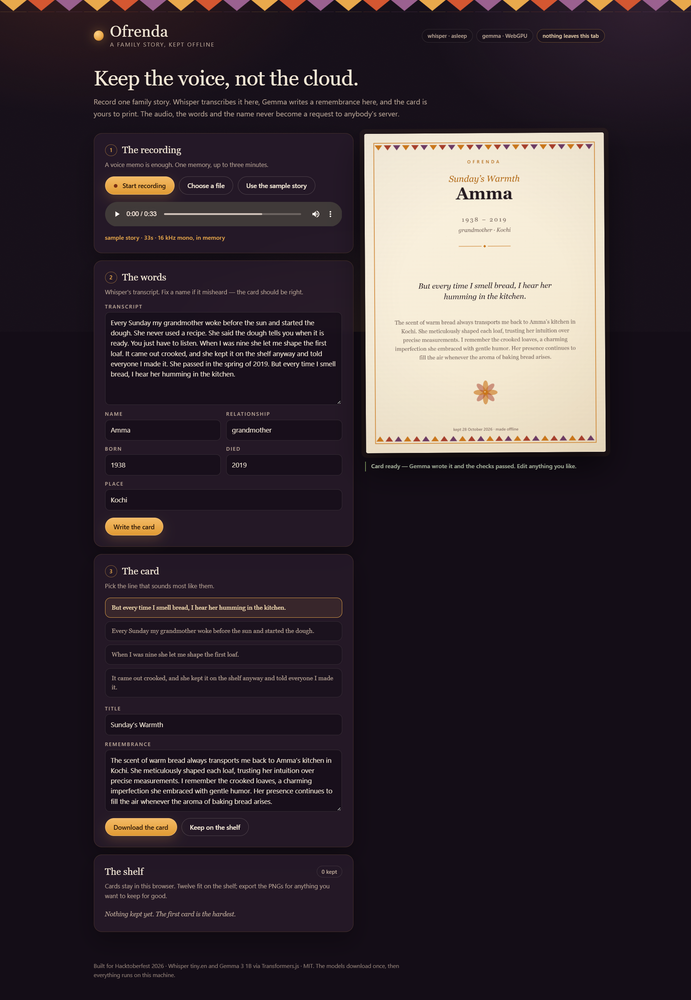
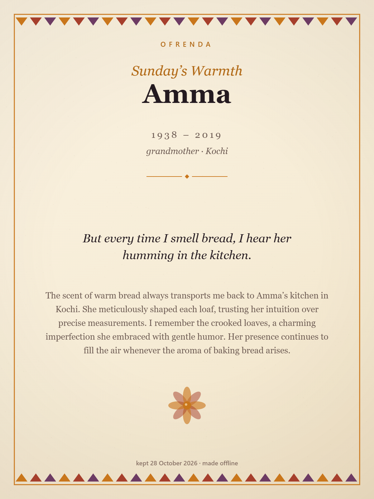

# Ofrenda

**A family story, kept offline.**

Ofrenda is an offline oral-history keeper. Record one family story — a voice memo is
enough — and it becomes a printed keepsake: a transcript you can correct, a line worth
keeping, a short remembrance, and a card you can put on the wall.

Two open-weight models do the listening and the writing. Everything else — the quote
selection, the word limits, the clichés, the layout, the fallbacks — is ordinary code
with tests.

Nothing is uploaded. Not the audio, not the words, not the name.



## Why

Día de los Muertos is a night for remembering out loud. "Ghost in the Machine" is the
same idea from the other side: the ghost is the voice inside the recording.

The obvious way to build this is to send the audio to a transcription API and the
transcript to a chat API. That means a grandmother's voice leaves the laptop, lands in
someone's logs, and stays there. For a memory you intend to keep for decades, that is a
strange bargain.

Open weights make the other bargain possible: download the model once, and the machine
in front of you can do the listening. A grandmother's voice should never be an API call.

## What it does

1. **The recording.** Use the microphone, choose an audio file, or load the sample story.
   The audio is decoded in the tab to 16 kHz mono and never leaves it. Three minutes max —
   one memory, told once.
2. **The words.** Whisper tiny.en transcribes it locally on WebGPU (with a WASM fallback).
   The transcript is editable, because a machine will mishear a name and the card should
   be right.
3. **The card.** The code scores every sentence and offers the four best as the quote.
   Gemma 3 1B writes a title and a three-sentence remembrance, both checked before they
   are allowed onto the card. You can edit anything. The card is painted on a canvas at
   1200 × 1600 and downloads as a PNG; the shelf keeps the last twelve in localStorage.



## The division of labour

A 1B model is good at writing and bad at being trusted. So the code decides what is
true and what fits; the model only decides how it sounds.

| Job | Done by | Why |
| --- | --- | --- |
| Audio → text | Whisper tiny.en (q8, ONNX) | Speech recognition is a solved, local problem |
| Title + remembrance | Gemma 3 1B (q4, ONNX) | Prose is what a small model is actually good at |
| Sentence splitting, quote scoring | `src/text.js` | A family's wall quote is a decision, not a generation |
| Word limits, clichés, invented dialogue | `src/remembrance.js` | The model may not put words in anyone's mouth |
| Fallback prose | `src/remembrance.js` | A card must exist even when the model fails |
| Line wrapping, card geometry | `src/card-layout.js` | Deterministic, testable, no canvas required |
| Painting, PNG export | `src/card-render.js` | A dumb painter on top of a tested layout |
| Shelf | `src/store.js` | Twelve keepsakes in localStorage, no account |

### The guards

Gemma's output is accepted only if it passes all of these:

- 18–95 words, 2–4 sentences, ends with punctuation;
- no markdown, headings or lists;
- no greeting-card language ("loving memory", "rest in peace", "forever in our hearts");
- no invented dialogue — a quotation mark is an automatic rejection, because the model
  does not know what anyone actually said;
- no machine voice ("circuits", "as an AI", "language model");
- the title is one line, 2–6 words, and cannot be an instruction.

When a guard rejects the model, the card falls back to prose built from the facts:
name, relationship, place, and the plain truth that the story was spoken out loud and
kept on one machine. The fallback is not a failure state; it is a different kind of
honest.

## Run it

There is no build step, no bundler, no API key, and no dependency to install.

```bash
git clone https://github.com/4-thkind/ofrenda.git
cd ofrenda
python -m http.server 8080
# open http://localhost:8080
```

A local server is required because the app uses ES modules and `fetch`.

The first run downloads the models from the Hugging Face CDN (about 40 MB for Whisper,
about 570 MB for Gemma) and the browser caches them. After that the app works offline.

**Browser:** a current Chrome or Edge gives you WebGPU, which is much faster. Without it
the app falls back to WASM on the CPU — it still works, it just takes longer.

## Tests

```bash
npm test
```

44 assertions across four files, no test framework, no dependencies:

- `test/audio.test.mjs` — duration labels, the three-minute limit, limit messages;
- `test/text.test.mjs` — transcript cleanup, sentence splitting (including "Dr."),
  quote scoring and tie-breaking, year formatting, ellipsis;
- `test/remembrance.test.mjs` — the bouncer: length, clichés, markdown, model apologies,
  invented dialogue, machine voice, title rules, fallbacks;
- `test/card-layout.test.mjs` — wrapping, truncation, the line budget, reading order,
  long names, overflow, no NaN coordinates.

The browser-only parts (audio decoding, model inference, canvas) are verified by running
the app, not by mocks.

## Privacy model

- Audio is decoded in the tab with the Web Audio API and held in memory only.
- Whisper and Gemma run on the device through Transformers.js and ONNX Runtime Web.
- The shelf is `localStorage` under `ofrenda.shelf.v1`.
- The only network requests are the model files from `huggingface.co` and the
  Transformers.js bundle from `jsDelivr`. Self-host both for a fully offline copy.
- The audio player uses an object URL for the file you chose; it is revoked when the page
  is closed.

## Limits

- English only: Whisper tiny.en is an English-only model, deliberately.
- One speaker, three minutes. This is a keepsake, not an archive.
- A 1B model writes well and repeats itself; edit the fields. The card is a draft you own.
- The first model load wants roughly a gigabyte of free memory. The listener is released
  before the writer wakes so the two never share the GPU.
- The sample story is synthetic speech, written for the demo. The names are fictional.

## Layout

```
index.html            three steps and a preview
src/app.js            the controller: intake → transcript → card → shelf
src/asr.js            Whisper tiny.en, WebGPU with WASM fallback
src/model.js          Gemma 3 1B, guarded prompts
src/audio.js          decode to 16 kHz mono, limits
src/text.js           cleanup, sentences, quote scoring, years
src/remembrance.js    validation, guards, deterministic fallbacks
src/card-layout.js    pure geometry: wrapping, blocks, fit
src/card-render.js    canvas painter: paper, papel picado, marigold
src/store.js          the shelf
src/styles.css        the altar at night
test/                 the four test files and one runner
demo/                 sample audio, screenshots, exported card
```

## License

MIT. Whisper is MIT; Gemma 3 is distributed under the Gemma Terms of Use (open weights,
not an OSI licence); Transformers.js is Apache-2.0.

Built for the [Hacktoberfest Open-Source AI Challenge, Week 4: Ghost in the Machine](https://dev.to/challenges/hacktoberfest-week4-2026-10-26).
